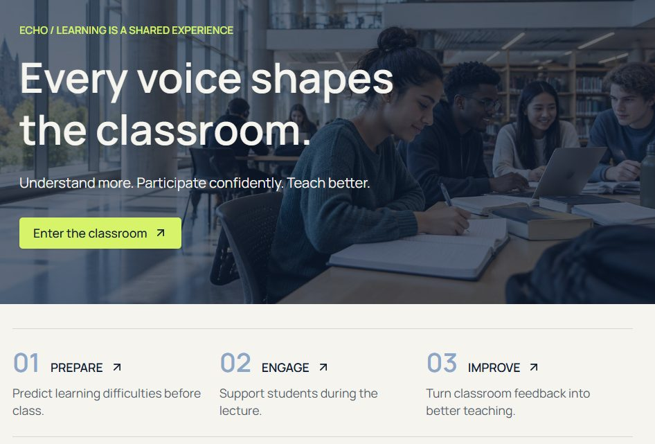

# Echo — no student's confusion goes unheard

**Team UniVoice** (Bihan, Peiru, Kin Tong Lei) · GreatUniHack 2026 · Reply "AI on Campus" challenge

> Before class we predict. During class we listen. After class we learn.

In a lecture of 200, confusion is silent: students don't raise their hands, international students get lost on jargon and idioms, and lecturers only find out at the exam. Echo covers the whole lecture:

| | What happens | Where |
|---|---|---|
| **Before class** | **ClassTwin**: five AI virtual students (international student, weak-maths transfer student, missed-the-prerequisite first year, practical learner, top student) pre-read the slides and flag where real students will get lost. An advisor agent turns this into the 3 most useful fixes for the lecturer and a prep pack for students. | `classtwin/` (working, runs on Claude) |
| **During class** | Live captions with technical terms and British idioms explained in plain English and Chinese, anonymous "I'm lost" taps and questions, and AI clustering that tells the lecturer *why* the room is lost and what to say. | `echo/` + Lovable web app |
| **After class** | A recap for students and a "prediction vs actual" check that recalibrates the virtual students. | Lovable web app |



## Run ClassTwin

```bash
cd classtwin
pip install -r requirements.txt
export ANTHROPIC_API_KEY=...        # or OPENAI_API_KEY; with no key it runs in mock mode
python make_sample.py               # creates a sample stats lecture PDF
streamlit run app.py
```

Upload a lecture PDF and press **Run pre-check**: you get a confusion heatmap (5 students × slides), the top 3 fixes and a student prep pack.

`api.py` exposes the same pipeline as `POST /analyze` (FastAPI) so an automation tool such as n8n can run it whenever new slides are uploaded.

## Architecture

```
Slides (PDF) → text per slide → 5 student agents in parallel (Claude) → per-slide confusion JSON
            → advisor agent → top 3 fixes + student prep pack → heatmap UI / API
Lecture audio → speech-to-text → term agent (explanations + Chinese)
Student questions + "I'm lost" taps → clustering agent → what to re-explain
```

## Repo

- `classtwin/` — the pre-class prototype (Python, Streamlit, Claude / OpenAI)
- `echo/` — demo lecture transcript, the prompts for every agent, the demo dataset and the prompt used to build the Lovable web app
- `docs/` — screenshots of the Echo web app

The classroom figures in the demo dataset (class size, questions, "I'm lost" taps) are simulated for the demo.
